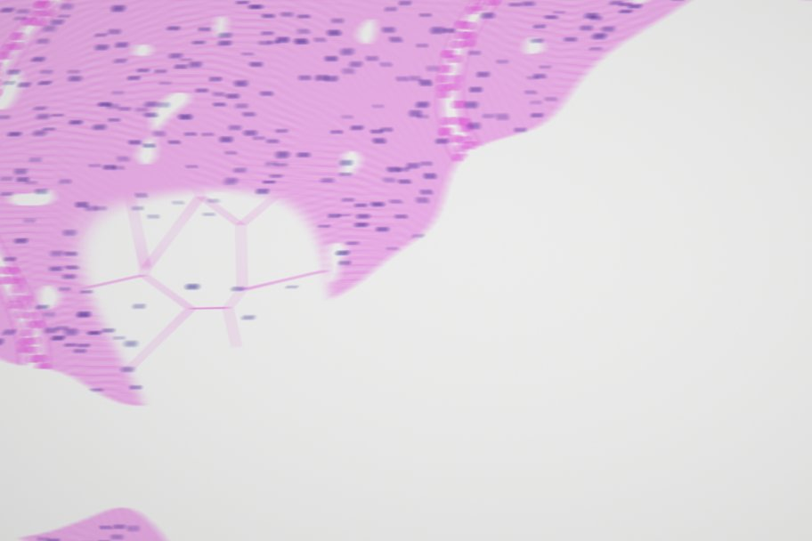
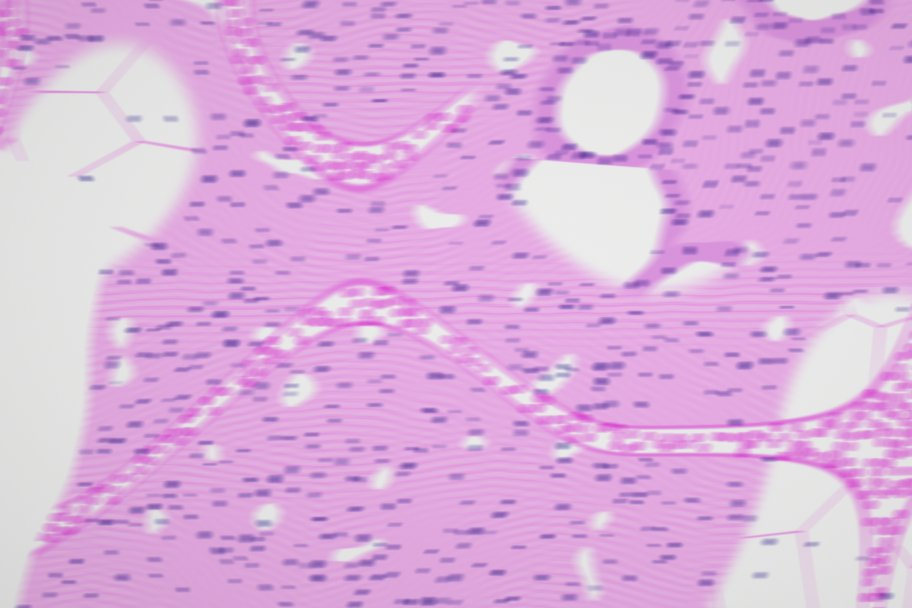

# P1.12c: The virtual camera (Checkpoint A)

- **Status:** Done
- **Branch:** `m1/p1.12c-the-virtual-camera`
- **Spec:** [phases.md](../phases.md#p112c-the-virtual-camera-checkpoint-a)
- **Size:** estimated 1,440 (code 700 · tests 450 · examples 200 · docs-as-code 60 · glue 30) → **measured 2,009** (code 865 · tests 781 · examples 346 · docs-as-code 10 · glue 7), **×1.40**. The first estimate, 1,190, came from P1.12b's split.

## Summary

Tetera has a virtual MIChrome 20: a camera that images the simulated slide through the fitted objective, under the virtual light, wherever the virtual stage has it, live, at the real camera's modes and rates. **Checkpoint A holds:** the virtual instrument renders H&E live on the GPU while the stage moves. The phase's *Done when*:

- **A full frame takes 40 ms or less on the GPU still, and while jogging at up to 250 µm/s at 20×.** Faster, it falls short:

  | Jogging at 20× | Each frame made in (median) | At most | Rate |
  |---|---|---|---|
  | still, 12 bits | 17.2 ms | | 7.24 fps |
  | still, 8 bits | 26.7 ms | | 14.49 fps |
  | 100 µm/s | 18.2 ms | 58 ms | 14.49 fps |
  | 250 µm/s | 38.1 ms | 40 ms | 14.49 fps |
  | 500 µm/s | 48.5 ms | 82 ms | 14.49 fps |
  | 1 mm/s | 74.0 ms | 123 ms | 14.49 fps |

  At 500 µm/s a frame is 8.5 ms over the budget, and at 1 mm/s 34 ms over: each frame's newly visible tiles, about 150 of them at 1 mm/s. The camera still keeps its rate, as a frame takes less than the 69 ms between frames on average.
- **Each mode reaches its rate in real time on this PC,** still, none dropped:

  | Mode | 12 bits | 8 bits | Each frame made in, 12 and 8 bits |
  |---|---|---|---|
  | 0, 5472 × 3648 | 7.24 of 7.24 fps | 14.49 of 14.49 | 17.2 and 26.7 ms |
  | 1, 2736 × 1824 | 26.57 of 26.57 | 53.14 of 53.14 | 5.1 and 8.4 ms |
  | 2, 1824 × 1216 | 33.87 of 33.87 | 67.26 of 67.26 | 3.2 and 3.2 ms |

  The CPU fallback reaches every rate on a 192 × 128 sensor too.
- **With a seed and stepped time, frames repeat bit for bit** on the same backend, the stage jogging, on the CPU and on the GPU.
- **The camera passes the contract suite,** linear and with the SDK's processing, on the CPU and on the GPU.

## What was built

- **In `tetera-sim`:**
  - **`camera`:**
    - `MODES`, the MIChrome 20's modes and rates, and `mode`;
    - `FrameTiming`: each row's exposure, the line time and the interval;
    - `SdkProcessing`, the SDK's processing as an option;
    - `VirtualCameraConfig`, `Scene` and `Backend`;
    - `VirtualCamera`, which implements `Camera`: streaming, free-running or on a software trigger, snaps, drops and events, on the stage's clock;
  - **`optics`:** `Optics::defocus_for_blur`, the blur's inverse; `Motion::travel`, and the grid widened only on the side the field moves to;
  - **`sensor`:** `expose` on all cores;
  - **`gpu`:** `HeTiles::frame_into`, a raw frame straight into a frame's bytes.
- **In `tetera-compute`:** the sensor's kernel writes rows at a frame's stride; `CudaBackend::download_into_bytes`.
- **ADR-0016,** updated: the sensor, motion, timing and the held defocus.
- **The `virtual-camera` example,** and `tetera-imaging` as a dev-dependency of `tetera-sim` for its JPEGs.
- **No new external dependencies.**

## Ideas taken from OScope

The modes and rates are OScope's measurements of the MIChrome 20, as the spec gives them. The SDK's processing follows what OScope found (plan R4): white balance and gamma, then about 58,000 levels above an offset near 2,000.

## How to try it

```bash
cargo run --release -p tetera-sim --features cuda --example virtual-camera
TETERA_CUDA=1 cargo test -p tetera-sim --features cuda -- camera::
```

The JPEGs are in `target/virtual-camera/`.

## Checkpoint A

The demo script is [Checkpoint A](../manual-tests.md#checkpoint-a-the-virtual-instrument-renders-he-live) in the manual tests. The agent ran it on 2026-11-27, under the owner's standing approval; the owner runs it again at Checkpoint C, with B's and C's.

Run on 2026-11-27, in WSL2 Ubuntu 24.04, on the RTX 3070 Ti Laptop GPU, at `fab42c4`, release builds.

- [x] `cargo xtask gate checkpoint`: **G2 pass** on a fresh clone at `fab42c4`, in 4 min 50 s: every suite, every example's smoke run on the CPU and on the GPU, the docs and the licences. Again at `9b969c0`, after the last commit to the code: G2 pass. The gate's mutants step is left to each phase's own runs, which covered the camera.
- [x] `cargo run --release -p tetera-sim --features cuda --example he-sample`: the sample's PNGs, each view on the GPU within 5.4e-4 OD of the CPU's. **The agent judged them plausible:** stroma with wavy collagen, nuclei with chromatin, vessels lined with red cells, fat cells, lumens, and a section that ends against bare glass. They are synthetic in their regularity: the collagen too even, the fat cells drawn as thin polygons. The owner judges them again at Checkpoint C.
- [x] `cargo run --release -p tetera-sim --features cuda --example virtual-optics`: the full field still 5.0, 10.0 and 25.4 ms at 5×, 20× and 50×; moving 100 pixels a frame, 5.0 to 32.0, 15.1 to 16.3 and 28.3 to 33.5 ms, all within 40 ms.
- [x] `cargo run --release -p tetera-sim --features cuda --example virtual-sensor`: the noise against the model as in P1.12b; the GPU's sensor differing from the CPU's in 1 count of 19,961,856.
- [x] `cargo run --release -p tetera-sim --features cuda --example virtual-camera`: **live H&E on the GPU while the stage jogs.** 42 frames in 3.1 s at 14.49 fps, the camera's rate, none dropped, each made in 46.8 ms (median) after its last row, the stage from x = 2,037 to 4,867 µm; jogging and each mode as in the summary.

Two of the live frames, at 20×, jogging along x at 1 mm/s, the sensor's 2 × 2 shown as one pixel and scaled to 912 × 608:





The nuclei are smeared along the jog by about 14 of these pixels, 83 of the sensor's, as 1 mm/s over 10 ms is 10 µm at 0.12 µm a pixel, and the vessels lean by the rolling shutter's readout.

## Manual test

Run by the agent on 2026-11-27, in WSL2 Ubuntu 24.04, on the RTX 3070 Ti Laptop GPU, on the phase's branch at `fab42c4` and `9b969c0`, release builds.

- [x] `cargo run --release -p tetera-sim --features cuda --example virtual-camera`: as in the summary and Checkpoint A. The agent looked at the JPEGs: H&E at 20×, smeared along the jog and sheared by the rolling shutter, white-balanced to the light.
- [x] `cargo run --release -p tetera-sim --example virtual-camera -- --smoke`: each mode at its rate on a 192 × 128 sensor on the CPU, and `smoke: ok`; with `--features cuda`, the same on the GPU.
- [x] `TETERA_CUDA=1 cargo test -p tetera-sim --features cuda -- camera::`: the camera's 15 tests pass, the contract suite on the CPU and the GPU among them; 108 in `tetera-sim` and 93 in `tetera-compute` in all.

## Performance

- **A still full frame takes 17 to 27 ms:** the field 10 ms at 20×, the sensor 1 ms, and the raw frame straight into the pool's pinned frame, about 4 ms for 40 MB. Before, into pageable memory and copied into the frame, it took 31 to 44 ms.
- **Jogging makes the newly visible tiles,** about 0.2 ms each: at 20× a tile is 20 µm, so at 1 mm/s each frame makes three or four columns of them, for two depth groups.
- **A mode's first frame after a change** makes its planes on the GPU and its pool: the example takes a snap before timing a mode. Switching between modes back and forth makes them again each time.
- **On the CPU,** a 192 × 128 sensor makes a frame in 12 to 60 ms in a release build.
- **Under the tests' parallel load,** the camera's renders on rayon's global pool queued behind other tests' work for seconds; each camera now has its own threads.

## Design notes and deviations from the plan

- **Frames are made once their last row has read out,** from where the stage's plan had it from the first row's start to the last row's end; the velocity over that span is the frame's motion. The position in a frame's metadata is the stage's at the middle of that span.
- **The first frame starts when `start` is called,** not when the thread gets going, so a stepped clock gives the same frames every run.
- **The frame interval is the mode's readout, or the exposure if longer.** The line time is the readout over the mode's rows.
- **Falling behind:** after each frame, the frames whose time has wholly passed are dropped, counted in the next frame's `dropped_before` and said in a `Dropped` event.
- **No objective fitted, or the light off:** the sensor's black and its noise.
- **The defocus is held where the blur reaches 48 sensor pixels** (`max_blur`), so a frame far from focus, a stage at z = 0 against a section at 1 mm, takes no longer than one near it. At 50× that is 7 µm from focus, which autofocus (P1.16) may want further.
- **The SDK's processing makes the modes 16 bits deep instead of 12;** 8 bits are its top 8, with the offset's black level.
- **No ROI and no extra binning:** the binned modes are the camera's own; `roi_step` is `None`. A later phase can add an ROI if autofocus wants faster frames.
- **The grid is widened only on the side the field moves to.** Widened every way, a rolling shutter's whole readout of travel made a small sensor's grid 2,000 level pixels across.

## Tests, and the mutants

- **17 new tests:**
  - the modes and their rates, with and without the SDK's processing;
  - the contract suite, linear and with the SDK's processing;
  - frames at the mode's interval on a stepped clock, against the spec's rates;
  - frames repeating bit for bit from a seed in stepped time, the stage jogging;
  - the objective, the light and the focus changing the frame; no objective, no light;
  - the held defocus, `defocus_for_blur` against `blur`;
  - the SDK's processing, and through the camera in 16 and 8 bits;
  - a camera falling behind, and saying how many frames it lost;
  - on the GPU: the contract, frames repeating, and the CPU's statistics;
  - in `tetera-compute`: rows at a stride;
  - the grid widened on one side.
- **Broken on purpose,** as the spec asks: **the mode's frame interval,** the 8-bit and deep rates swapped. At first one test caught it, as the timing test compared the frames with the camera's own interval; it now compares them with the spec's rates, and two tests catch it:
  - the frames' interval: 69 ms where mode 0 at 12 bits takes 138;
  - the modes' rates.
- **Run 15 times,** both crates' tests passed each time.
- **Mutants:**
  - **the first runs missed 46:**
    - the camera's configuration checks, each one: a test of every refusal;
    - its frames against the model: a frame jogging along x and along y against `field_moving` and `expose` along the stage's path, its position in the metadata, the held defocus above and below the section, the 8-bit black level;
    - its stream: the pool used up and frames dropped until one comes back, no drops when keeping up, the interval after falling behind, a frame only once its last row has read out, and the camera's drop stopping its stream;
    - `frame_into`'s own shape checks, which the launch and the download already make: removed, and its stride now follows from its buffer;
    - the download into bytes, and the launch's shapes, now a function of their own, `sensor::pitch`, tested without a GPU;
    - one equivalent, excluded with its reason: the velocity's `secs > 0.0`, as a frame's span is never zero.
  - **The last runs missed none.** The 11 that timed out each make a frame's work enormous: a line time 72 times too long, a velocity of the stage's position rather than its change, the field at the whole MIChrome 20's size on a test sensor, the path's travel multiplied.

## Gate

`cargo xtask gate phase`: **G1 pass** at `27cc96d` and again at `9b969c0`, the last commit to the code, with the CUDA steps, the `virtual-camera` smoke run on the GPU among them. `cargo xtask gate checkpoint`: **G2 pass** on a fresh clone at `fab42c4` and at `9b969c0`. The Python step is skipped until M2.

## Size

| Part | Estimated | Measured | Why it differs |
|---|---|---|---|
| Code | 700 | 865 | the camera 776: its configuration and checks, the frame loop with drops and triggers, the scene's motion and focus, the SDK's processing, rendering on either backend into the pool; the rest the direct download and the one-sided grid |
| Tests | 450 | 781 | the contract on both backends, frames against the model along the stage's path, the stream's edge cases the mutants asked for |
| Examples | 200 | 346 | the jogging sweep, each mode's rate, a frame shown for people, and the strip kept out of the pool |
| Docs-as-code | 60 | 10 | the README's camera paragraph; ADR-0016's update is not counted |
| Glue | 30 | 7 | |
| **Total** | **1,440** | **2,009** | **×1.40** |

## Follow-ups and known gaps

- **Jogging faster than 250 µm/s at 20× is over the budget:** making the newly visible tiles in one launch, from buffers kept for reuse, is the likeliest gain.
- **A mode's planes are made again at each mode change.** Keeping one set for each mode would make switching free.
- **The held defocus at 50×** may be too near for autofocus (P1.16).
- **The server (P1.13)** puts the camera behind the API.
