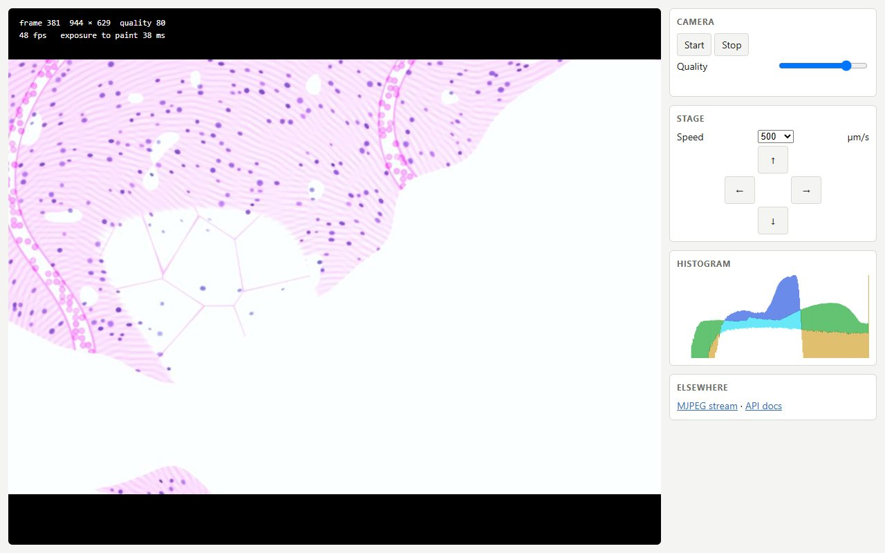
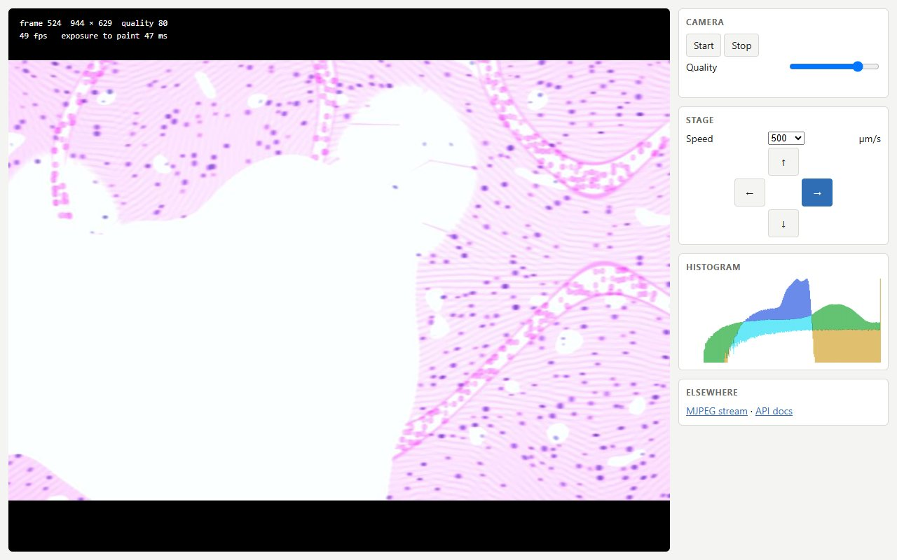

# P1.14c: MJPEG and the live-view page (Checkpoint B)

- **Status:** Done
- **Branch:** `m1/p1.14c-mjpeg-and-the-live-view-page`
- **Spec:** [phases.md](../phases.md#p114c-mjpeg-and-the-live-view-page)
- **Size:** estimated 810 (code 230 · tests 230 · examples 300 · docs-as-code 40 · glue 10) → **measured 709** (code 232 · tests 263 · examples 202 · docs-as-code 11 · glue 1), **×0.88**. The first estimate, 750, came from P1.14b's split.

## Summary

The server has a live view: a plain page at `/live-view` with the camera's image over the preview stream, a histogram from the live statistics, and buttons that start the camera and jog the stage. The preview also plays as MJPEG, a session for each viewer. **Checkpoint B holds:** live H&E in a browser page while jogging, from the server. The phase's *Done when*:

- **In mode 1 at 8 bits, the page shows the camera's rate, at least 30 fps:** 48 to 49 frames a second, by Windows' clock, still and while jogging. That is the camera's 53 by WSL2's clock, which runs slow on this PC (below).
- **From the exposure's end to the page's paint takes 100 ms or less on localhost, measured from the timestamps in each frame's header:** 32 to 49 ms, still and jogging. The header carries the server's own measure, from a frame's exposure to the page's acknowledgement of its paint, as the page's clock can't be compared with the server's.
- **The MJPEG stream plays in an ``:** Edge showed it as an image, 960 × 640, H&E on white glass.

## What was built

- **In `tetera-api`:**
  - **`media`,** Tetera's own routes, merged in front of the Things' (ADR-0017):
    - `/api/v1/preview/mjpeg`: `multipart/x-mixed-replace`, each part a JPEG with its length, from a preview session of its own for each viewer; the viewport, quality and rate from the query, the rest from `preview/defaults`; a bad query is a 400; the stream ends at once when the server shuts down;
    - `/live-view`: the page.
  - **`statistics`** on the `preview` Thing: the live statistics of the camera's latest frame, up to 10 a second, the mask at 48 × 32 so it reads quickly; stopped with the server.
  - **The camera's white balance starts balanced for the virtual light,** from its colour temperature and the sensor's quantum efficiency (`Instrument::white_balance`), unless one was saved: the glass is white from the start.
- **In `tetera_acquire::protocol`,** the header grows to 72 bytes: the last acknowledged frame's latency on the server's clock. Readers still take P1.14b's 64-byte header.
- **`live-view.html`,** with no framework:
  - the stream, each frame decoded with `createImageBitmap`, painted on the next animation frame, then acknowledged;
  - its rate, and the header's latency;
  - the viewport from the canvas's size, and the quality from a slider;
  - a histogram of the three colours, from `preview/statistics`;
  - *Start* and *Stop* for the camera, and arrows that jog the stage while held;
  - links to the MJPEG stream and the API's docs.
- **ADR-0019,** with the header's new field and what the clocks did.
- **The README's sections** on MJPEG and the live view, and the manual tests' Checkpoint B.
- **No new dependencies:** `futures-util`, from P1.14b's tests, is now a dependency of `tetera-api` itself.

## Ideas taken from OScope

None in this phase.

## How to try it

```bash
cargo run --release -p tetera-server
```

Then open `http://localhost:8310/live-view` in a browser on Windows and press *Start*.

## Manual test

Run by the agent on 2026-11-28, in WSL2 Ubuntu 24.04, on the RTX 3070 Ti Laptop GPU, release builds; the server at `b12506e`.

- [x] The MJPEG stream's content type, `multipart/x-mixed-replace; boundary=tetera-frame`: checked by the tests, and by Edge, which showed the stream as an image. The `curl` step itself wasn't run.
- [x] The MJPEG stream from Windows, in Edge: an image, 960 × 640, H&E on white glass.
- [x] `curl http://127.0.0.1:8310/preview/statistics` while the camera streamed: each colour's 256 bins, the 48 × 32 mask; 51,785 bytes, most of them the profiles.
- [x] `cargo test -p tetera-api`: 34 passed; with `tetera-acquire`, 54.

## Checkpoint B

The demo script is [Checkpoint B](../manual-tests.md#checkpoint-b-live-he-in-a-browser-page-while-jogging) in the manual tests. The agent ran it on 2026-11-28, under the owner's standing approval; the owner runs it again at Checkpoint C, with A's and C's.

Run in WSL2 Ubuntu 24.04, on the RTX 3070 Ti Laptop GPU, release builds, the page in Edge on Windows.

- [x] `cargo xtask gate checkpoint`: **G2 pass** on a fresh clone at `680627b`, in 4 min 52 s, and again at `f108f86`, after the last commit to the code (see Gate).
- [x] `cargo run --release -p tetera-server`: serving on the GPU, 5472 × 3648, the camera in its binned live mode.
- [x] **The page, opened from Windows, started with its *Start*:** live H&E at 20×, the glass white, at 48 to 49 fps by Windows' clock, 33 to 44 ms from exposure to paint, at 944 × 629, quality 80.
- [x] **Jogging with the page's arrows,** held 3 s each at 500 µm/s: the tissue slid smoothly left, then up, and stopped when let go, the stage moving from (2,000, 2,000) to (3,469, 3,353) µm; 48 to 49 fps, 32 to 49 ms, throughout. The histogram followed the field.
- [x] **The *MJPEG stream* link** played in its own page.
- [x] *Stop* stopped the camera.

The page, still and while jogging right:





**How it was run.** The desktop app's browser pane was hidden, which throttles a page's animation frames: there, the page ran at 8 fps and its link stepped down. So the agent drove a headless Edge on Windows over its DevTools protocol, which paints at full rate: it clicked the page's own buttons, read its overlay twice a second, and took the screenshots. The owner's run at Checkpoint C, in a visible browser, is the one that counts for the eye.

**WSL2's clocks.** The first run showed the page's latency climbing, 417 ms to 1.4 s over 10 s. Two clocks were to blame:

- **WSL2's wall clock is stepped** to keep up with Windows': it moved 2.5 s against Windows' in 10 s, and the server's mapping to UTC was 3 s behind Windows' clock when the run began;
- **WSL2's monotonic clock runs at 0.90 of Windows'** on this PC, with the `tsc` clock source: 13.61 s in WSL2 for 15.13 s in Windows.

So a page's clock can't measure the server's frames, however it corrects for the offset, and the header now carries the server's own measure (ADR-0019). Every time the server measures runs on WSL2's clock too: the camera's 53 frames a second are 48 by Windows'. **For the owner:** WSL2's other clock sources, `hyperv_clocksource_tsc_page` among them, might keep time better; switching is a system setting, left alone.

## Performance

- **The page keeps up with the camera:** 48 to 49 fps by Windows' clock, at 944 × 629. Each frame is decoded off the main thread, painted on the next animation frame and acknowledged, so the window of two never empties while the camera runs.
- **From exposure to paint, 32 to 49 ms** on the server's clock, as P1.14b's quick client measured to its receipt, 34 ms: the page's decoding and painting add little. By Windows' clock the same span is about 11 % longer.
- **The statistics' JSON is 52 KB** at the binned mode's size, mostly the profiles; the page reads it four times a second.

## Design notes and deviations from the plan

- **MJPEG is a session for each viewer,** not teta-wot's `MjpegStream`, which encodes one stream of one size whether anyone watches or not (ADR-0019). A viewer that reads slowly holds its own socket, and the session's slot keeps the newest JPEG for it.
- **The MJPEG stream watches the server's shutdown,** through teta-wot's `ShutdownToken`. Without it, the stream outlived the server: its parts kept coming past the 5 s grace, which is what the test now catches.
- **The statistics' mask is 48 × 32** on the Thing, not the 192 × 128 of `StatsParams`' default: as JSON, the larger mask alone is about 150 KB, read up to 10 times a second.
- **The latency is the server's,** in each header, from P1.14c: P1.14b's correction for the clocks' offset holds only while the two clocks run at the same rate, which WSL2's and Windows' don't. The header's new field goes at its end, as ADR-0019 allows, and a reader of the first header still works.
- **The camera's white balance starts balanced for the light,** which the spec didn't ask for: without it the virtual light's 3,200 K made the glass yellow on the page. A white balance written to the setting is kept, and one of exactly 1, 1, 1 is taken as unset.
- **Touching `tetera-acquire`** for the header, beyond the spec's `tetera-api`.

## Tests, and the mutants

- **4 new tests:**
  - **MJPEG in-process:** its content type and boundary, three parts each with its headers, its length, the JPEG at the viewport's size and a line's end; bad queries refused, a rate of 0 among them;
  - **MJPEG over a real socket:** the stream ends within 2 s of the server beginning to stop;
  - **the statistics and the page:** the statistics appear once frames come, with each colour's 256 bins and the 48 × 32 mask; the page is served; the statistics' thread stops with the server;
  - **the white balance** for a warm light and a cool one.
- **Tests extended:** the header's latency, its first version, a bare first header, a scrap, and the longest latency it can say; each frame's latency in the stream's tests; the camera's starting white balance.
- **Broken on purpose,** as the spec asks:
  - **MJPEG's part boundary,** each JPEG without the line's end after it: the in-process test failed, a part's length not the JPEG's plus two;
  - **the stream's end with the server,** the shutdown not watched: the test first hung, as parts kept coming and its read never timed out. It now fails within 10 s, "the stream outlived the server".
- **Run 15 times,** both crates' tests, 54 in all, passed each time.
- **Mutants:**
  - **the first run,** over MJPEG, the statistics and the page's route, 12 tested: 9 caught, 1 unviable, 2 missed: the MJPEG query's rate, which no test set, and the statistics' stop hook, which nothing looked at after the server stopped. Setting the property after the server stops fails quietly, so the test now checks the thread itself. The rerun over the two functions: 7 tested, all caught.
  - **the second,** over the header's latency and the white balance, 32 tested: 25 caught, 4 unviable, 3 missed: the length check at exactly 64 bytes, and a clamp only a latency of 71 minutes reaches. The clamp moved into the header, where a test reaches it. The rerun over the three functions: 23 tested, 19 caught, 4 unviable, **none missed**.
  - **No exclusions.**

## Gate

`cargo xtask gate phase`: **G1 pass** at `f108f86`, the last commit to the code, with the CUDA steps, over the packages the change reaches; it had passed at `680627b` too. `cargo xtask gate checkpoint`: **G2 pass** on a fresh clone at `680627b`, in 4 min 52 s, and at `f108f86`, in 2 min 57 s. The gate's mutants step is left to the phase's own runs. The Python step is skipped until M2.

## Size

| Part | Estimated | Measured | Why it differs |
|---|---|---|---|
| Code | 230 | 232 | MJPEG and the page's route 147, the statistics on the Thing 36, the header's latency 20, the white balance 23 |
| Tests | 230 | 263 | |
| Examples | 300 | 202 | the page, shorter than planned |
| Docs-as-code | 40 | 11 | the README's sections |
| Glue | 10 | 1 | |
| **Total** | **810** | **709** | **×0.88** |

## Follow-ups and known gaps

- **WSL2's clock runs at 0.90 of Windows' on this PC:** every rate and time the server measures is in its clock. A clock source that keeps time is the owner's choice; a real camera's timestamps (M5) come from its own clock.
- **The page is a developer's page** until the web app's viewer (M4).
- **The statistics' JSON** is 52 KB at the binned mode's size, mostly the profiles; a binary stream of their own could carry them if a page reads them faster.
- **Two viewers of the same size do the work twice,** as P1.14b's notes say for the stream.
